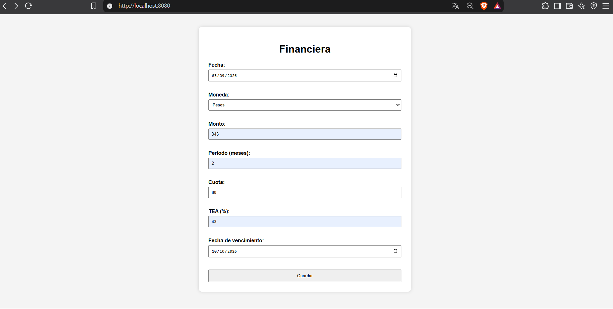
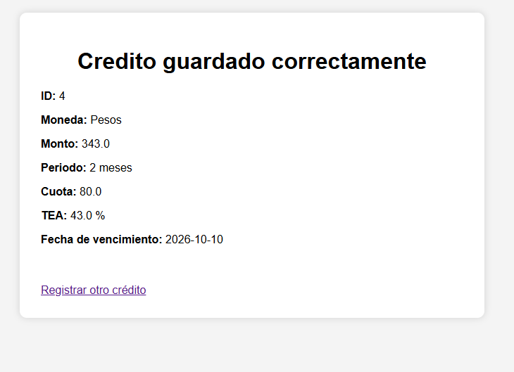
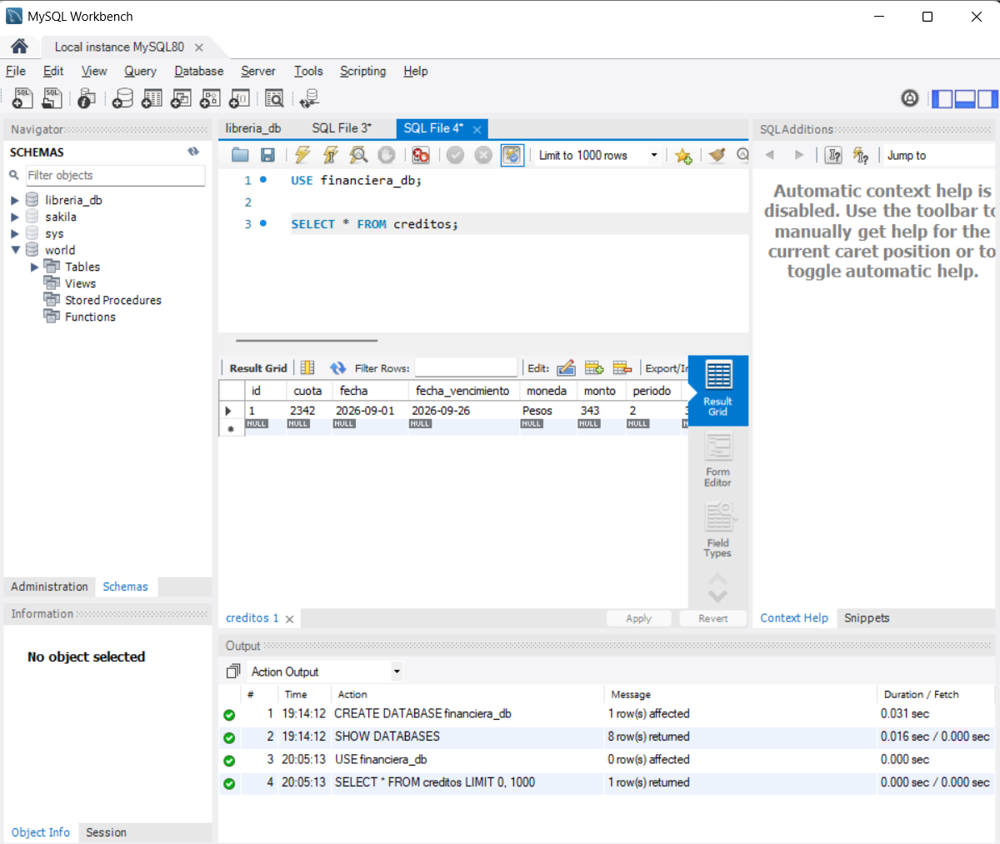
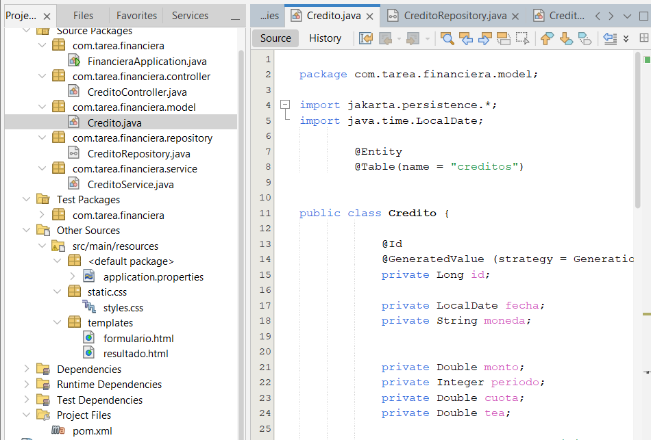

# Tarea 2 - Tecnologías para Desarrollo en Internet

## Autor **Elliot Kenneth Villafana Pasten 118006642**


## Descripción

Aplicación web desarrollada con Spring Boot que permite capturar información de un crédito mediante un formulario, almacenar los datos en una base de datos MySQL y posteriormente mostrar los datos registrados en una segunda vista.

El proyecto utiliza una arquitectura basada en Spring MVC y Spring Data JPA.

## Tecnologías utilizadas

- Java 21
- Spring Boot
- Spring MVC
- Spring Data JPA
- Thymeleaf
- MySQL
- Maven
- HTML
- CSS
- Apache NetBeans

## Requisitos

Para ejecutar el proyecto se necesita tener instalado:

- Java JDK 21
- MySQL Server 8
- Un navegador web
- MySQL Workbench (opcional, para consultar la base de datos)

No es necesario instalar Maven manualmente porque el proyecto incluye Maven Wrapper.

## Configuración de la base de datos

Primero se debe iniciar MySQL.

Después, crear una base de datos llamada:

```sql
CREATE DATABASE financiera_db;
```

La configuración de conexión se encuentra en:

```text
src/main/resources/application.properties
```

La configuración debe tener los siguientes datos:

```properties
spring.datasource.url=jdbc:mysql://localhost:3306/financiera_db
spring.datasource.username=root
spring.datasource.password=TU_CONTRASEÑA 

spring.jpa.hibernate.ddl-auto=update
spring.jpa.show-sql=true
```

Se debe reemplazar `TU_CONTRASEÑA` por la contraseña correspondiente a la instalación local de MySQL.

La tabla `creditos` es creada automáticamente por Hibernate a partir de la clase `Credito`.

## Cómo ejecutar la aplicación

### Opción 1: Git Bash / UCRT64

Abrir una terminal dentro de la carpeta del proyecto y ejecutar:

```bash
./mvnw spring-boot:run
```

### Opción 2: Windows CMD o PowerShell

Ejecutar:

```cmd
mvnw.cmd spring-boot:run
```

Cuando aparezca un mensaje indicando que Spring Boot inició correctamente, abrir un navegador e ingresar a:

```text
http://localhost:8080
```

## Uso de la aplicación

1. Abrir `http://localhost:8080`.
2. Capturar los datos solicitados en el formulario.
3. Seleccionar la moneda.
4. Ingresar monto, periodo, cuota y TEA.
5. Seleccionar las fechas.
6. Presionar el botón **Guardar**.
7. La información se almacena en MySQL.
8. La aplicación muestra una segunda página con los datos registrados.

## Consulta de registros en MySQL

Para comprobar los registros almacenados se puede utilizar MySQL Workbench y ejecutar:

```sql
USE financiera_db;

SELECT * FROM creditos;
```

## Funcionamiento general

La aplicación sigue el siguiente flujo:

```text
Formulario HTML
      |
      v
CreditoController
      |
      v
CreditoService
      |
      v
CreditoRepository
      |
      v
MySQL
```

### Model

`Credito.java` representa los datos que se almacenan en la tabla `creditos`.

### Repository

`CreditoRepository.java` proporciona las operaciones necesarias para guardar y consultar información en MySQL mediante Spring Data JPA.

### Service

`CreditoService.java` contiene la lógica utilizada para guardar los créditos.

### Controller

`CreditoController.java` recibe las peticiones del navegador, muestra el formulario y procesa los datos enviados.

### Views

- `formulario.html`: permite capturar la información.
- `resultado.html`: muestra los datos después de guardarlos.


## Capturas de pantalla

### Formulario



### Resultado del registro



### Registro almacenado en MySQL



### Estructura del proyecto en NetBeans


